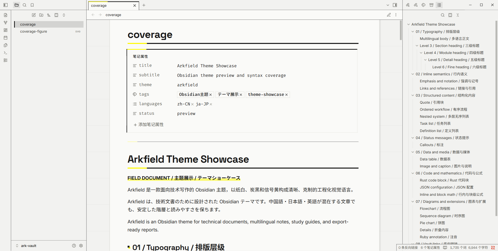
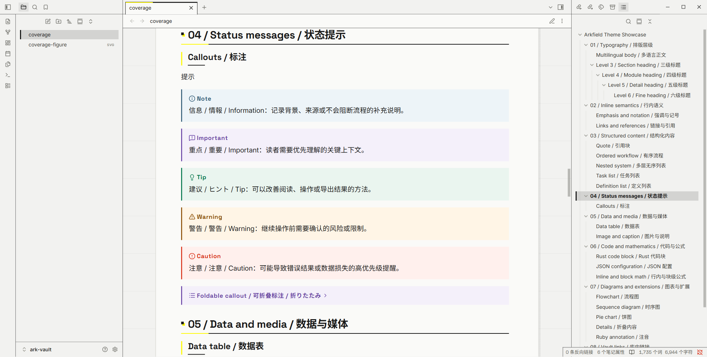
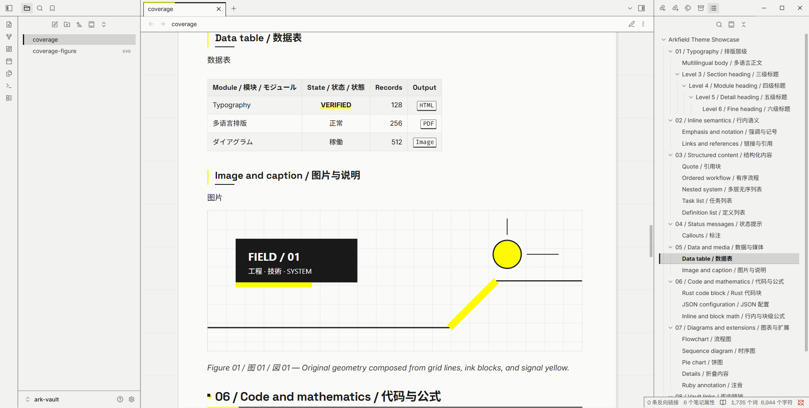
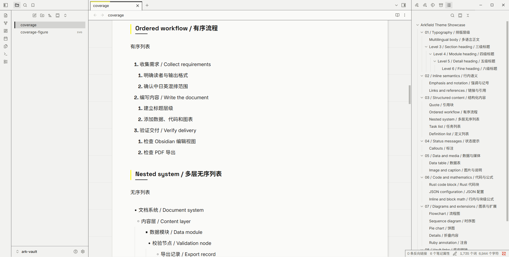
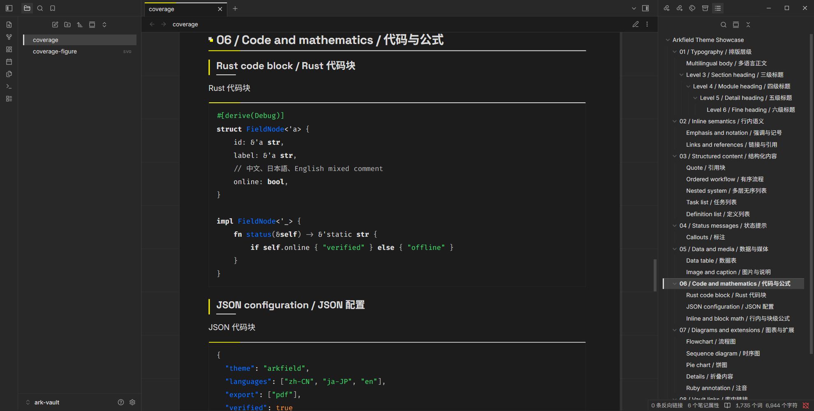

# Arkfield

Arkfield 是一个以《明日方舟：终末地》视觉语言为参考的 Obsidian 浅色主题，由 [Typora 版 Arkfield](https://github.com/genskyff/typora-arkfield) 移植而来：纸白、炭黑与信号黄，方角、细规则线，以及笔记纸张两侧克制的工程网格。

## 覆盖范围

- 文档：内联标题、1~6 级标题、正文、链接与双链、标签、列表/任务列表、引用、标注（Callout）、表格、代码、数学公式、Mermaid、笔记属性、脚注、嵌入、HTML 折叠块/定义列表/注音。
- 编辑：实时预览与源码模式，标题、列表符号、代码块与水平线在两种视图中保持一致。
- 应用外壳：标签页、侧栏与文件列表、大纲、命令面板、菜单、设置、提示框、通知与状态栏。
- 导出：PDF 导出单独处理分页、长表格、代码换行和背景色还原；`<div style="page-break-after: always;"></div>` 在阅读视图中显示为分页标记。

GitHub 风格的五种提示（NOTE、TIP、IMPORTANT、WARNING、CAUTION）沿用 GitHub 的图标与配色，其中 CAUTION 与 WARNING 分开着色。

深色模式没有单独设计：切换到深色时，Arkfield 的结构线与信号黄会叠加在 Obsidian 默认深色配色上。

完整格式与中日英混排效果见 [主题展示文档](assets/coverage.md)——把它和 `assets/coverage-figure.svg` 复制到库中打开即可检查。

<details>
<summary><strong>预览</strong></summary>











</details>

## 安装

Obsidian 只在文件夹名与 `manifest.json` 中的 `name` 完全一致（区分大小写）时才会列出主题，因此文件夹必须命名为 `Arkfield`。

1. 从 [Releases](../../releases) 下载 zip 并解压
2. 把解压出的 `manifest.json` 与 `theme.css` 放入 `<库>/.obsidian/themes/Arkfield/`
3. 在“设置 → 外观 → 主题”中选择 `Arkfield`

## 开发

通过 [mise](https://mise.jdx.dev/getting-started.html) 管理：

```shell
mise install
mise run build
mise run check
mise run fmt
```

`arkfield.css` 是唯一需要维护的主题样式源码；`theme/theme.css` 由 `mise run build` 把源码与 `fonts/` 中的字体（以 base64 内嵌）拼接生成，不要手动编辑。

构建后把 `theme/` 下的 `manifest.json` 与 `theme.css` 复制到库的 `.obsidian/themes/Arkfield/`。Obsidian 检测到库中当前主题的 `theme.css` 变化后会自动重新加载，无需重启；修改 `manifest.json` 后需要重启 Obsidian。通过 `Ctrl+Shift+I` 打开开发者工具检查编辑区和应用界面。

发布时先更新 `theme/manifest.json` 中的版本号，再推送带 `v` 前缀的对应标签（如 `v1.0.0`）；工作流会校验生成物，并把 `theme/` 打包成 `arkfield-<标签>.zip` 附加到 Release。

## 参考

- [Ark UI Skill](https://github.com/Brandon030722/ark-ui-skill)
- [Build a theme](https://docs.obsidian.md/Themes/App+themes/Build+a+theme)
- [Theme guidelines](https://docs.obsidian.md/Themes/App+themes/Theme+guidelines)
- [Embed fonts and images in your theme](https://docs.obsidian.md/Themes/App+themes/Embed+fonts+and+images+in+your+theme)
